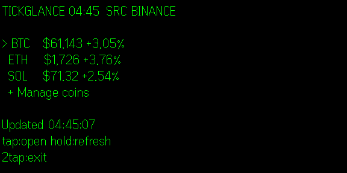
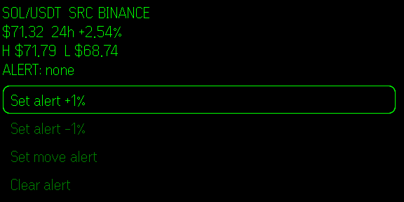
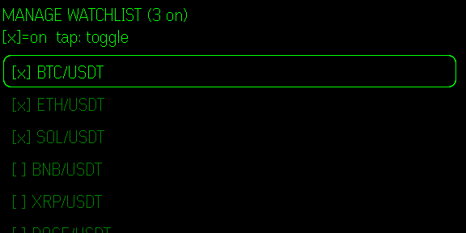
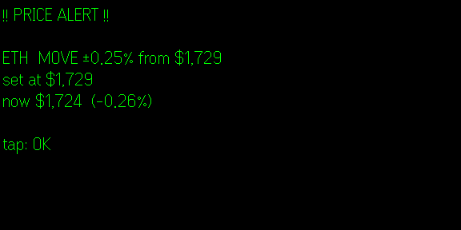
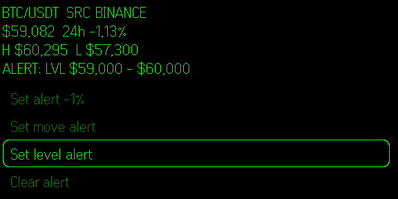
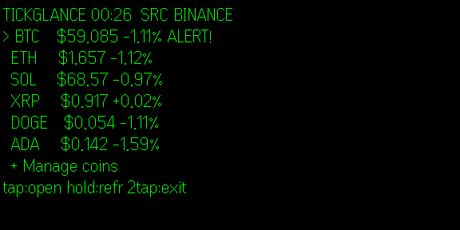

# TickGlance — crypto watchlist & price alerts on your glasses

**Even Realities "Heads Up" hackathon — Track 03: Exchanges & Stocks**

Your crypto watchlist and price alerts on your Even G2 glasses. Glance at
live Binance prices and **set, clear, and receive price alerts with temple
taps — in seconds, without touching your phone.**

- Editable watchlist with live price and 24h change, formatted for the
  576×288 monochrome G2 display. It defaults to BTC / ETH / SOL, and a
  **Manage coins** screen (one extra scroll stop under the watchlist) lets
  you toggle any of 8 Binance USDT pairs — BTC, ETH, SOL, BNB, XRP, DOGE,
  ADA, LINK — in or out with temple taps. The watchlist persists across
  restarts (WebView local storage); removing a coin also disarms its alert.
- Per-coin detail: price, 24h change, 24h high/low.
- **Read-and-write, not just notify:** arm an alert (+1 %, −1 %, a ±0.25 %
  move alert, or a **level alert**) from the glasses in two taps; clear it
  just as fast; edit the watchlist from the glasses too; when a refresh
  sees the price cross, the glasses switch to a full-screen alert.
- **Level alerts (new in v0.3.0, 2026-11-26):** traders think in round
  price levels — "BTC at 60k" — more than in percents. One tap arms an
  alert on the next round-number boundary above *and* below the current
  price (BTC steps of $1,000, ETH $100, SOL $10, DOGE $0.01 — the step is
  one order of magnitude below the price's leading digit). Added after
  organizer feedback during build week; the detail screen shows the armed
  band, e.g. `LVL $59,000 - $60,000`.
- Alerts persist across restarts (WebView local storage).
- Read-only public data. **No API keys, no account, no funds, no trading —
  ever.** Alerts are in-app display state; they place no orders.

## Screenshots (official simulator, live Binance data)

| Watchlist | Coin detail |
|---|---|
|  |  |

| Manage coins | Alert fired — captured live, 23 Nov 2026 |
|---|---|
|  |  |

| Level alert armed (v0.3.0) | Watchlist with the alert armed |
|---|---|
|  |  |

The alert screenshot is a real firing, not a mock-up: a ±0.25 % move alert
armed on ETH at $1,728.55 fired on a live refresh at $1,724.09 (−0.258 %),
125 seconds after it was set. When the data source is unreachable the app
keeps the last prices and marks them
[`STALE`](docs/screenshots/stale.png) — it never invents numbers.

## How to run

Prerequisites: Node ≥ 20.17, npm. For the simulator on Linux you also need an
X display (Xvfb works) and the WebKitGTK runtime (`libwebkit2gtk-4.1-0`).

```bash
npm install

# 1) Dev server (the app is a Vite + TypeScript web app)
npm run dev -- --port 5173 --strictPort

# 2) Simulator (no account needed) — in a second terminal
npx evenhub-simulator http://localhost:5173
#    headless automation API: add --automation-port 9898

# 3) Production build + .ehpk package (local, no login)
npm run build
npx evenhub pack app.json dist -o tickglance.ehpk
```

The packaged build for this entry (v0.3.0) is `tickglance.ehpk`
(40,548 bytes, SHA-256
`e1fee2d08cf3a30fc67638253d760e70a421f5f9088398122f78efb15e300948`);
it is not tracked in git (rebuild it with the commands above — the packer
is deterministic, and a re-pack of these exact inputs was verified to
reproduce it byte-for-byte).

Unit test for the alert logic (21 assertions, no SDK involved):

```bash
node test/alerts-logic-test.mjs
```

Pinned toolchain: `@evenrealities/even_hub_sdk` 0.0.16,
`@evenrealities/evenhub-cli` 0.2.0, `@evenrealities/evenhub-simulator` 0.9.5.
Pin versions — the official docs examples lag the published SDK (see
"Platform note" below).

## Controls

| Input | Watchlist | Detail | Manage coins |
|---|---|---|---|
| Scroll up/down | Move coin cursor | Move action cursor | Move symbol cursor |
| Tap | Open coin detail | Run selected action | Toggle symbol on/off |
| Long-press | Refresh prices now | Refresh prices now | Refresh prices now |
| Double-tap | Exit app | Back to watchlist | Back to watchlist |

On the alert screen, a single tap acknowledges the alert and returns to the
watchlist.

## Architecture

```
tickglance/
├── app.json            Even manifest: package_id com.lexa.tickglance,
│                       network whitelist (1 public origin, nothing else)
├── index.html          Vite entry
├── src/
│   ├── main.ts         UI state machine (watch / detail / alert / manage
│   │                   screens; detail and manage menus are native list
│   │                   containers), Even Hub event routing, data layer
│   │                   (Binance-only fetch, 30 s auto-refresh, stale state),
│   │                   watchlist editing with local-storage persistence
│   └── alerts.ts       Pure alert logic (arm / check / label) — unit-tested
│                       separately from the SDK (21 assertions, all passing)
├── test/
│   └── alerts-logic-test.mjs
└── docs/screenshots/   Simulator captures used above
```

Data layer: Binance-only, as Track 03 requires — the sole data source is
Binance's public market-data host
(`https://data-api.binance.vision/api/v3/ticker/24hr`, keyless, weight 2 per
call against a 6000/min budget). There is no fallback source: if the
primary fails, the app keeps showing the last fetched prices and marks
them `STALE`, and the on-screen header always labels the active source
(`SRC BINANCE`). The app sends plain GETs only (no custom headers), which
is what makes the WebView CORS model work with this
`Access-Control-Allow-Origin: *` endpoint.

**Platform note (found in our feasibility spike, 2026-11-18):** with SDK
0.0.16, temple clicks arrive as `sysEvent` with `eventType` *missing*
(protobuf omits the 0 = CLICK default), not as the `textEvent` shown in the
docs' first-app example. `src/main.ts` routes all event channels and
normalizes a missing `eventType` to CLICK; a docs-only handler never fires.
A second finding from the same spike: scroll delivery to a *text* container
is unreliable after a page rebuild, so both menus (detail actions, Manage
coins) are native **list containers** — the OS owns focus/scroll and
delivers selections as `listEvent` with the selected index.

## Safety

- Read-only public market data only; no exchange account is connected.
- No API keys exist in this project; nothing secret is bundled into the
  `.ehpk` (anyone can extract a published build — treat it as public).
- The app never holds, moves, or trades user funds. "Write" actions are
  local app state (alerts, watchlist, navigation, refresh) that complete
  in < 1 s.

## Pre-existing code declaration

Declared honestly, per the hackathon rule that pre-existing code must be
disclosed. Timeline of this codebase:

- **2026-11-18 — feasibility spike (before build week).** We first built a
  throwaway hello-world (`hello-g2`, an Even "Your First App" exercise with
  a tap counter) to verify the toolchain end-to-end in the official
  simulator. The spike contributed: the Vite/TypeScript project skeleton,
  `app.json` structure, the bridge boot pattern, and the `sysEvent`
  click-routing fix described above.
- **2026-11-18 — TickGlance v0.1.0 (before build week).** The first working
  version of this entry (watchlist, detail screen, alert system, data
  layer) was written on top of the spike scaffold during entry preparation,
  still before build week, and is declared here as pre-existing code.
- **2026-11-19 — fallback removed.** v0.1.0 originally had a second,
  fallback market-data source. Because the hackathon rules limit a track
  to its listed apps and that source belongs to another track's list, the
  fallback was removed entirely, leaving the app Binance-only (with the
  last-prices `STALE` behaviour instead of a second source).
- **2026-11-23 — v0.2.0 (build week).** Screen/list polish (column-aligned
  watchlist rows, taller detail menu), the Manage-coins watchlist editing,
  and the final package were built during build week. The same day, a live
  alert firing and the STALE / NO DATA states were captured in the
  simulator as submission evidence.
- **2026-11-26 — v0.3.0 (build week).** Level alerts (next round-number
  boundary above and below the current price) added in response to
  organizer feedback that traders think in price levels rather than
  percents; verified end-to-end in the simulator (armed on BTC at
  $59,081.98 → band $59,000–$60,000) and covered by 9 new unit-test
  assertions (21 total). The demo video predates this feature and shows
  v0.2.0; level alerts can be tried in the live browser demo.
- **Official Even Realities material:** the app structure follows the
  official Even Hub docs (Quickstart / Your First App / Simulator /
  Packaging) and uses the official npm packages listed above.
- **Reference pack:** GoogleChrome `modern-web-guidance` (Apache-2.0) was
  installed locally as a best-practice reference for the web code; no code
  was copied from it into this project.
- Everything else in `src/` was written for this hackathon entry.

## License

MIT — see [LICENSE](LICENSE).

## Feature requests for the platform teams

Written for the Heads Up hackathon's request to name what the APIs we used were missing — all four come from building TickGlance.

**Even Realities / Even Hub SDK**

1. Input event typing is inconsistent: temple clicks arrive as `sysEvent` with `eventType` undefined, while the docs example reads them from `textEvent`. Please guarantee a populated `eventType` on every input event (or correct the docs), so apps do not have to subscribe to both channels defensively.
2. Scrolling text containers is unreliable in practice. Please provide a supported programmatic scroll API for text containers, or document native list containers as the canonical scrollable-menu pattern.
3. A documented way to inspect a packed `.ehpk` (for example `evenhub pack --list`) would help builders verify exactly what ships.

**Binance**

4. `api.binance.com` returns HTTP 451 (geo-restriction) even for public market data, while `data-api.binance.vision` serves the same data keyless with CORS enabled. Please document `data-api.binance.vision` as the official endpoint for browser/WebView clients, so embedded apps do not have to discover it by trial and error.
